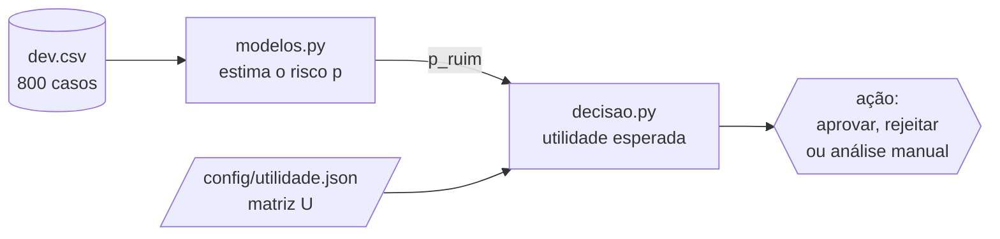
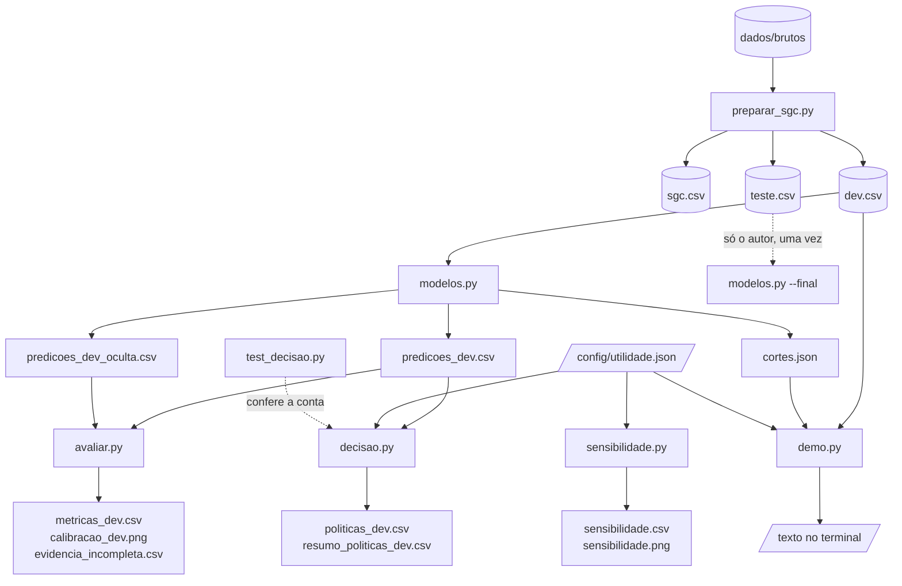
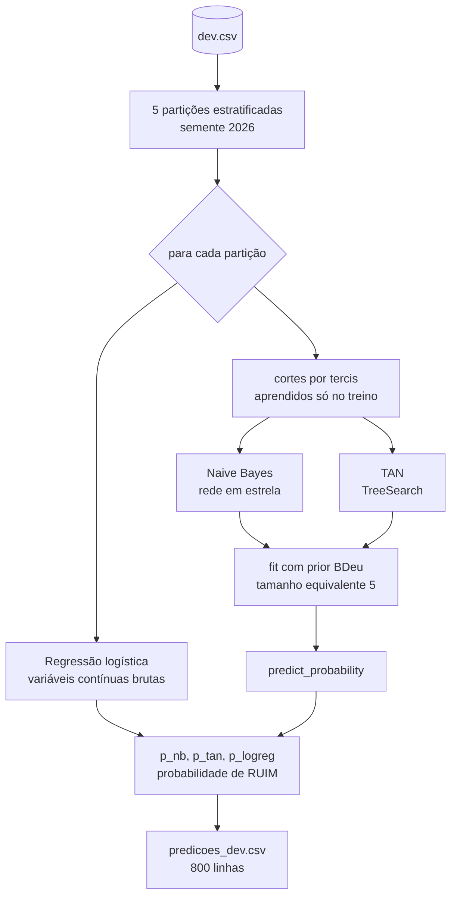
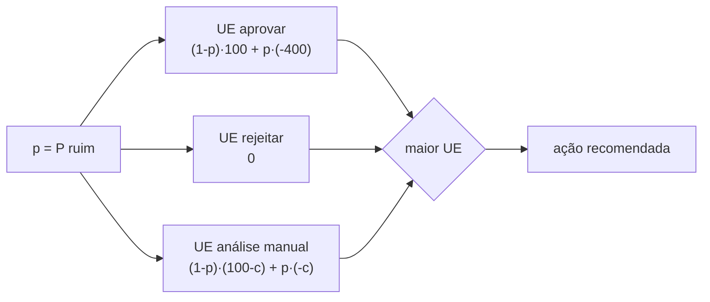
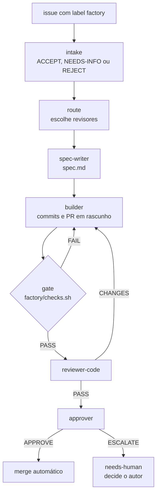
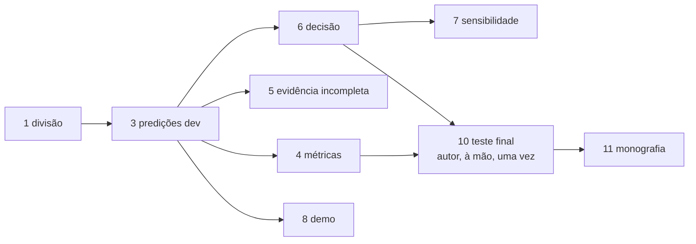

# Arquitetura

Visão do experimento como o [PLANO.md](../PLANO.md) o define. Este documento não cria decisão nova: onde houver conflito, vale o plano. Os diagramas descrevem o desenho **previsto**; um script só passa a existir depois que a issue dele for mergeada.

## 1. Visão geral

O sistema não tem frontend, backend nem banco de dados. São scripts Python que leem CSV e gravam tabelas e figuras em `resultados/`. A ideia central do trabalho é separar duas coisas: **estimar o risco** (rede bayesiana) e **escolher a ação** (utilidade esperada).

## 2. Scripts e arquivos trocados

Sete scripts depois das issues 01 a 07 (hoje existem `preparar_sgc.py` e o `baseline_logreg.py` herdado, que a issue 01 apaga). Cada seta é um arquivo em disco; nenhum modelo é salvo (sem `pickle` nem `joblib`).

Regras que o desenho impõe:

- `avaliar.py` nunca treina; só lê predições.
- `demo.py` treina de novo ao abrir, nas 4 partições que não contêm o caso pedido, para mostrar o mesmo risco de `predicoes_dev.csv`.
- O único arquivo de dados que o código lê é `dev.csv`. `teste.csv`, `sgc.csv` e `dados/brutos/` só são tocados por `preparar_sgc.py`.
- A linha pontilhada do teste final não é executada por agente: o caminho `--final` é escrito pela factory e testado com linhas do dev; quem roda sobre o teste é o autor, à mão, uma vez.

## 3. Dentro de `modelos.py`

Pontos a lembrar na defesa:

- `kredit`: 0 = ruim, 1 = bom. A classe positiva é **ruim**; toda coluna `p_*` é probabilidade de ruim.
- A discretização em 3 faixas vale só para as redes. A regressão logística recebe as 3 contínuas (`laufzeit`, `hoehe`, `alter`) sem faixas.
- Os cortes são aprendidos no treino de cada partição, para o teste da partição não vazar na discretização.
- `record_id` sai antes de qualquer chamada ao `pgmpy`.

## 4. Camada de decisão

A rede entrega `p`, a probabilidade de o crédito ser ruim. A camada de decisão calcula a utilidade esperada de cada ação e escolhe a maior.

Os valores da matriz vêm de `config/utilidade.json`; os números acima são os da proposta demonstrativa do plano e não ficam escritos no código. Empate (tolerância 1e-9): análise manual, depois rejeitar, depois aprovar.

Como cada UE é uma reta em `p`, a política equivale a limiares sobre `p`. A contribuição do trabalho é **derivar esses limiares dos custos de forma explícita** e mostrar que isso exige probabilidade calibrada. Por isso a comparação é a tabela 2×2 (modelo × regra), e não "utilidade esperada contra limiar".

## 5. Como o código é construído

O código é escrito pela software factory, uma issue por PR, e o autor relê tudo antes do commit de congelamento.

No máximo 3 rodadas por issue; se acabarem sem passar, o job vai para `needs-human`.

## 6. Ordem de execução do experimento

O passo 2 (teste de fumaça do `pgmpy`) abre o `modelos.py` e o 9 (hill climbing) é opcional; ambos ficam fora do desenho acima. O que decide o autor, e não o código: qual modelo vai para a tabela 2×2, se a calibração entra, e os valores de custo.
